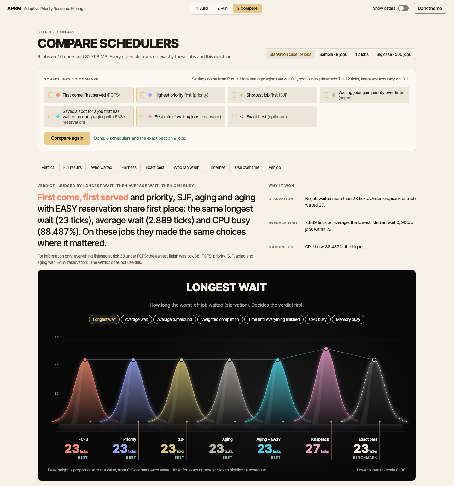

# APRM: Adaptive Priority Resource Manager

[](https://github.com/krishnasharma1493/APRM/actions/workflows/ci.yml)
[](LICENSE)

APRM is an online, non-preemptive job scheduler for one machine with two resources, CPU cores and memory, written in C11. Jobs arrive over time. Each job needs some cores and some memory for a known number of ticks, and the scheduler decides which waiting job starts next. The same C engine runs in three places:

- **Console program:** runs any jobs CSV through any policy and writes results, metrics and an event log.
- **Website:** the engine compiled to WebAssembly in a single offline HTML file. You build a case, watch every decision with a plain-English reason, and compare all schedulers side by side.
- **Python tools:** generate seeded workloads, run experiments E1 to E6, check invariants and conformance, and draw the report figures.

This is a course project for Analysis and Design of Algorithms, B.Tech CSE (3rd semester), Faculty of Technology, University of Delhi.


## Contents

- [Features](#features)
- [Quick start](#quick-start)
- [The website](#the-website)
- [The schedulers](#the-schedulers)
- [Console program](#console-program)
- [How it fits together](#how-it-fits-together)
- [Repository map](#repository-map)
- [Build and test commands](#build-and-test-commands)
- [Testing and quality checks](#testing-and-quality-checks)
- [Experiments and figures](#experiments-and-figures)
- [Setup](#setup)
- [Documentation](#documentation)
- [Optional: GitHub Pages copy](#optional-github-pages-copy)
- [Authors and ownership](#authors-and-ownership)
- [Licence](#licence)

## Features

- **Six scheduling policies and an exact solver**, all in `core/`:
  - first come, first served;
  - static priority;
  - shortest job first;
  - aging (waiting jobs gain priority without re-sorting the heap);
  - aging with an EASY-style reservation;
  - a knapsack batch selector.
- **Deterministic results.** Ties go to the earlier arrival, then the lower id. No floating point is used in scheduling decisions, so GCC, Clang and WebAssembly produce byte-identical output.
- **Pure, safe C11.** The core uses the standard library only, with no I/O and no global state. It compiles cleanly with `-Wall -Wextra -Werror`, and the test suite also runs under AddressSanitizer and UndefinedBehaviorSanitizer, with fuzzing and allocation-failure injection.
- **An offline website.** It is one HTML file with the engine, fonts and scripts inside. It opens from `file://` with the network off, works in light and dark themes and at phone width, can be used fully from the keyboard, and respects reduced motion.
- **Reproducible experiments.** Every workload has a recorded seed, results are summarised with 95% confidence intervals, and one command redraws every figure.

## Quick start

You need a C compiler, Make, Python 3, Node.js and Emscripten (see [Setup](#setup)):

```sh
git clone https://github.com/krishnasharma1493/APRM.git && cd APRM
python3 -m venv .venv && source .venv/bin/activate
pip install -r requirements.lock.txt

make                 # console program → build/aprm
make test            # C unit tests, golden cases and website tests
pytest tests/py      # property, conformance, summary and figure checks
make wasm            # engine for the website → web/vendor/aprm.js
make web             # one offline file → web/dist/index.html
open web/dist/index.html    # Linux: xdg-open; WSL: explorer.exe web/dist/index.html
```

The page needs no server. It is ready when it shows "Engine ready". To serve it locally instead, run `python3 -m http.server 8765 --directory web/dist` and open <http://127.0.0.1:8765/>.

## The website

The site has three steps, shown as tabs in the top bar. **Show details** adds a table under every chart, and the theme button switches between light and dark.

| Step | What you do there |
| --- | --- |
| **1 Build** | Set the machine (cores and memory), then add, edit or delete jobs. You can start from one of six examples, generate random jobs, import or export a jobs CSV (up to 1 MB; bad rows are listed by line), or copy a link that reopens the exact case. |
| **2 Run** | Pick a scheduler and watch it work on a laptop whose screen shows the cores and memory in use. You can play, step, jump to the end, change the speed and add a job mid-run. Panels show the waiting queue, running jobs, the timeline, the "why" decision log and the live metrics. |
| **3 Compare** | Run every scheduler, plus the exact best for 9 jobs or fewer, on the same jobs. The verdict ranks schedulers by longest wait, then average wait, then CPU busy. Charts show the measures (as glowing peaks), wait spread, fairness by priority, the gap to the exact best, who ran when, timelines, use over time and per-job results. |



The website never decides which job runs. Every decision, number and log line comes from the C engine through WebAssembly. The page only draws them.

## The schedulers

| Policy (`--policy`) | On the website | How it picks the next job |
| --- | --- | --- |
| `fcfs` | First come, first served | Earliest arrival first |
| `priority` | Highest priority first | Highest priority (0 to 9) first |
| `sjf` | Shortest job first | Shortest duration first |
| `aging` | Waiting jobs gain priority over time | Score = priority + α × time waited, stored as the integer key `1000·b − alpha_milli·r`, so the heap never re-sorts |
| `reserve` | Saves a spot for a job that has waited too long | Aging plus an EASY-style reservation: once a job has waited T ticks, it gets a start time that no later job may delay |
| `knapsack` | Best mix of waiting jobs | Picks the batch of waiting jobs that best fills the cores and memory (scaled dynamic programming, accuracy ε) |
| `--exact` | Exact best | Searches every schedule of up to 9 jobs, knowing the future, for the smallest total wait. It is the benchmark every scheduler is measured against. |

Every policy breaks ties by earlier arrival, then lower id. The full specifications are in [`docs/BLUEPRINT.md`](docs/BLUEPRINT.md) §3.

### Defaults and limits

| Setting | Default | Range |
| --- | --- | --- |
| CPU cores | 16 | 1 to 1,000,000 |
| Memory | 32,768 MB | 1 to 1,000,000,000 MB |
| Aging rate α (`--alpha-milli`, thousandths) | 0.1 (100) | 0 to 10 (0 to 10,000) |
| Reservation threshold T (`--threshold`) | 50 ticks | 0 to 1,000,000 |
| Knapsack accuracy ε (`--eps`) | 0.1 | 0.01 to 1 |
| Jobs per run | | up to 1,000,000 (console program), 5,000 (website) |

The source for these values is [`docs/PRD.md`](docs/PRD.md) §3.

## Console program

```sh
build/aprm --in jobs.csv --out results.csv [--policy fcfs|priority|sjf|aging|reserve|knapsack]
           [--cpu 16] [--mem 32768] [--alpha-milli 100] [--threshold 50] [--eps 0.1]
           [--log log.txt] [--metrics metrics.json] [--exact] [--help]
```

Example:

```sh
build/aprm --in data/presets/memory_hog.csv --out results.csv --policy reserve --metrics metrics.json
```

- **Input:** a CSV with the header `id,arrival,duration,cpu,mem,priority`.
- **Output:** one row per job with its start, finish, wait and turnaround.
- **Metrics:** JSON with the waits, turnaround, weighted completion, makespan and utilisation.
- **Exit codes:**
  - 0: success;
  - 1: bad arguments;
  - 2: input file error;
  - 3: invalid job;
  - 4: internal error.

The exact formats are in [`docs/PRD.md`](docs/PRD.md) §5. Six example inputs are in [`data/presets/`](data/presets/).

## How it fits together

```text
                 ┌──────────────────────────── core/ (C11) ────────────────────────────┐
                 │ heap · event loop · policies · reservation · knapsack · exact solver │
                 │ metrics · event log · JSON and CSV                                   │
                 └──────────────┬─────────────────────────────────┬─────────────────────┘
                                │                                 │
                     cli/main.c │                                 │ wasm/api.c (Emscripten)
                                ▼                                 ▼
                 build/aprm (console program)          web/vendor/aprm.js (WebAssembly)
                                │                                 │
     tools/*.py: workloads,     │                                 │ web/js/*.js: draws Build,
     experiments, summaries,  ◄─┘                                 └►Run and Compare; never decides
     property and conformance                                       web/build.mjs → web/dist/index.html
     checks → tools/plot_figures.py → docs/report/figures/
```

The C engine is the only place that decides which job runs next. The console program and the website call the same engine, and CI checks that both give identical output on every golden case and on random workloads.

## Repository map

| Path | What it holds |
| --- | --- |
| [`core/`](core/) | The scheduler in C11: heap, event loop, policies, reservation, knapsack, exact solver, metrics, event log, JSON and CSV. The only place scheduling decisions are made. |
| [`cli/`](cli/) | The console program `build/aprm` |
| [`wasm/`](wasm/) | WebAssembly exports, the build script, and the Node.js runner used for conformance |
| [`web/`](web/) | The website: `index.html`, `css/`, `js/` (classic scripts), self-hosted `fonts/`, and `build.mjs`, which bundles everything into `web/dist/index.html` |
| [`tools/`](tools/) | Python: workload generator, experiment runner, summaries, property and conformance checks, timing, figures |
| [`tests/`](tests/) | C unit tests (`c/`), hand-worked golden cases (`cases/`), console checks (`cli/`), Python tests (`py/`), website tests (`web/`), headless-browser checks (`demo/`), hardening (`hardening/`) |
| [`data/`](data/) | Preset example CSVs and small, clearly fake sample summaries |
| [`docs/`](docs/) | Project documents (see [Documentation](#documentation)) |
| [`.github/`](.github/) | CI workflow, issue template and pull request template |

## Build and test commands

```sh
make              # console program → build/aprm
make debug        # with invariant checks after every step
make sanitize     # AddressSanitizer + UndefinedBehaviorSanitizer, full test suite
make test         # C unit tests, golden cases and website tests
make hardening    # fuzzing, allocation-failure injection, stress, unsafe-call grep
make wasm         # WebAssembly bundle → web/vendor/aprm.js (needs emsdk)
make web          # website → web/dist/index.html (needs Node.js and npm)
make web-test     # website unit tests only (Node.js)
make clean        # remove build output
pytest tests/py   # Python checks
```

Browser checks need Google Chrome:

```sh
node tests/demo/rehearse_cdp.mjs web/dist/index.html --offline   # the demo path, network off
node tests/demo/check_layout_cdp.mjs web/dist/index.html         # layout at desktop and phone widths
node tests/demo/click_matrix_cdp.mjs web/dist/index.html         # every control on every page
```

## Testing and quality checks

| Layer | What is checked |
| --- | --- |
| C unit tests | Heap, CSV, JSON, config, engine, policies, reservation, knapsack, exact solver, metrics, event log, null arguments |
| Golden cases | 21 hand-worked cases in `tests/cases/`, each with its expected output per policy, re-checked on paper |
| Sanitisers and hardening | ASan and UBSan over the full suite, fuzzing, allocation-failure injection, stress tests, and a grep for unsafe calls |
| Python | Invariant properties on random workloads, the starvation bound for reservation, "exact is never beaten", summary formats, figure smoke tests |
| Conformance | The console program and the WebAssembly build give identical results on golden cases and random workloads |
| Website | Unit tests for every script, contrast checks, copy checks, and engine-backed Compare checks against the console program |
| Browser | Offline rehearsal, layout at several widths and both themes, and a click matrix over every control, in headless Chrome |

CI (`.github/workflows/ci.yml`) runs all of these on every push and pull request. Nothing merges unless every check is green.

## Experiments and figures

There are six experiments, E1 to E6, defined in [`docs/BLUEPRINT.md`](docs/BLUEPRINT.md) §6. They run the console program over seeded workloads, 30 seeds per setting (50 instances per job count for E6). With the virtual environment active and `build/aprm` built:

```sh
for e in E1 E3 E4 E5 E6; do python tools/run_experiments.py --experiment $e --jobs 8; done   # raw runs → results/raw/ (E2 reuses E1)
python tools/summarize.py --experiments E1 E2 E3 E4 E5 E6        # means and 95% intervals → results/summaries/
python tools/plot_figures.py --input results/summaries           # figures → docs/report/figures/
```

The full grid is 2,600 runs and takes seconds. Without `--input`, `plot_figures.py` draws from `data/sample_summaries/`, whose numbers are fake, and every title then says "SAMPLE DATA". `results/` and the figures are not committed; the commands above regenerate them.

## Setup

Versions are written in one place only: `docs/TOOLCHAIN.md`. Do not copy version numbers from anywhere else. Where a version matters (Emscripten), install the one that file lists.

### Prerequisites (check each with the command shown)

| You need | Check with | Needed for |
| --- | --- | --- |
| A C compiler (GCC or Clang) | `cc --version` | `make`, `make test` |
| GNU Make | `make --version` | every build command |
| Git | `git --version` | cloning |
| Python 3 with `venv` | `python3 --version` and `python3 -m venv --help` | tools, `pytest`, figures |
| A web browser (Chrome, Edge, Firefox) | open it | the website |
| Emscripten (emsdk), optional | `emcc --version`; "command not found" is fine if `~/emsdk` exists, because `make wasm` sources it itself | `make wasm` only (the website's engine file) |
| Node.js with npm | `node --version` and `npm --version` | `make web` (bundles the website) and the website tests; emsdk bundles a Node.js |

If a command prints "command not found", install that tool using the system section below, then run the check again. Everything except the website builds without Emscripten and Node.js.

### Windows (WSL2 Ubuntu)

1. Install WSL2 with Ubuntu (`wsl --install` in an administrator PowerShell, then restart).
2. In the Ubuntu terminal: `sudo apt update && sudo apt install build-essential git python3 python3-venv`.
3. Keep the repository inside the Linux file system (for example `~/aprm`), not under `/mnt/c`, and open it with the VS Code WSL extension.
4. Emscripten: see "Installing Emscripten" below.

### Mac

1. `xcode-select --install` (Clang and Make; `cc` and `make` then exist).
2. Python 3 from python.org (or Homebrew), and Git.
3. Emscripten: see "Installing Emscripten" below.

### Linux

1. Install `build-essential` (or your distribution's GCC + Make), `git`, `python3`, `python3-venv`.
2. Emscripten: see "Installing Emscripten" below.

### Installing Emscripten (only for `make wasm`)

Follow emscripten.org: clone `emsdk` into `~/emsdk`, then `./emsdk install <version from docs/TOOLCHAIN.md>`, `./emsdk activate <same version>`. `make wasm` finds `~/emsdk` on its own (it sources `emsdk_env.sh` for you). If emsdk is somewhere else, run `source <your emsdk folder>/emsdk_env.sh` in the same terminal first, then check `emcc --version`.

There is no prebuilt engine file to download: CI does not publish one and the `demo-ready` build does not exist yet. So the website needs `make wasm`, and therefore emsdk. Without it, everything else (console program, tests, figures) still works.

### Python environment (all systems)

From the repository folder:

```sh
python3 -m venv .venv
source .venv/bin/activate
pip install -r requirements.lock.txt   # exact versions; use this one
```

`requirements.txt` lists the package names only; install from it only if the lock file fails on your Python. The prompt shows `(.venv)` while the environment is active. In a new terminal, run `source .venv/bin/activate` again.

### Troubleshooting

| You see | Cause and fix |
| --- | --- |
| `make: cc: command not found` or similar | No C compiler. Mac: `xcode-select --install`. Ubuntu/WSL: `sudo apt install build-essential`. |
| `wasm/build.sh: emcc not found` | Emscripten is not installed or not active. See "Installing Emscripten"; check with `emcc --version`. All other steps still work. |
| Website shows "The engine file (web/vendor/aprm.js) did not load. Run "make wasm"..." | `web/vendor/aprm.js` is not built (it is never committed). Run `make wasm`, then reload the page. |
| `ModuleNotFoundError` (numpy, pandas, matplotlib, pytest) or `pytest: command not found` | The virtual environment is not active in this terminal. Run `source .venv/bin/activate`. |
| `python3 -m venv` fails on Ubuntu/WSL | `sudo apt install python3-venv`. |
| `pip` prints "A new release of pip is available" | A notice, not an error. Ignore it; do not upgrade pip for this project. |
| `summarize.py` prints a warning "no runs under raw/E2" | Expected: E2 is summarised from the E1 runs. Not a failure. |

## Documentation

| Document | Holds |
| --- | --- |
| [`docs/PRD.md`](docs/PRD.md) | Scope, configuration and limits, architecture and invariants, the API, CSV and summary contracts (§5), CI, testing, demo |
| [`docs/BLUEPRINT.md`](docs/BLUEPRINT.md) | Algorithm specifications (§3), website spec, experiments E1 to E6, report outline |
| [`docs/DECISIONS.md`](docs/DECISIONS.md) | Every decision (D-numbers) and open question (O-numbers) |
| [`docs/BACKLOG.md`](docs/BACKLOG.md) | The ordered issues with their "Done when" boxes |
| [`docs/RESEARCH_NOTES.md`](docs/RESEARCH_NOTES.md) | What each paper says and where it is used; glossary |
| [`docs/TOOLCHAIN.md`](docs/TOOLCHAIN.md) | Frozen tool versions |
| [`docs/design/`](docs/design/) | Website design authority (`PRODUCT.md`, `DESIGN.md`), fidelity notes and screenshots |
| [`docs/README.md`](docs/README.md) | The full documentation index |

## Optional: GitHub Pages copy

The laptop is the primary demo. The `deploy` job in `.github/workflows/ci.yml` can publish the website from `main`. It stays skipped until two settings are made, in this order:

1. Settings > Pages > Source: **GitHub Actions**.
2. `gh variable set PAGES_ENABLED --body true` (or Settings > Secrets and variables > Actions > Variables).

The next push to `main` that passes every check then publishes `web/dist/`, built in CI. To stop publishing, delete the variable.

## Authors and ownership

| Person | Owns |
| --- | --- |
| Krishna Sharma | The C core and every algorithm, console program, WebAssembly build, website, CI, golden cases, presets, and all Python except the figures |
| Ahaana Arya | `tools/plot_figures.py` (report figures for E1 to E6) and the paper check of the golden cases |

How to contribute: [`CONTRIBUTING.md`](CONTRIBUTING.md). Use of AI assistants is logged in [`docs/AI_USE.md`](docs/AI_USE.md).

## Licence

MIT, see [`LICENSE`](LICENSE). The research papers in `docs/research/` are not part of the repository and not covered by this licence; [`docs/research/README.md`](docs/research/README.md) says where to get each one.
