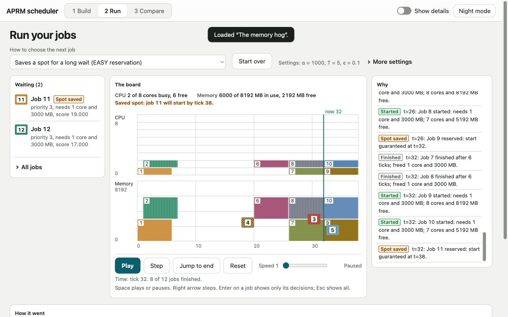

# APRM: Adaptive Priority Resource Manager

APRM is an online, non-preemptive job scheduler for one machine with two resources, CPU cores and memory, written in C11. Jobs arrive over time, each needing some cores and some memory for a known duration. The scheduler decides which waiting job starts next. It offers six policies: first come first served, static priority, shortest job first, aging (waiting jobs gain priority without ever re-sorting the heap), aging with an EASY-style reservation, and a knapsack batch selector. It also has an exact solver for small cases. The same C code runs as a console program and, compiled to WebAssembly, inside a website that works offline. There you can build a case, watch each decision with a plain-English reason, and compare schedulers side by side. Python tools generate seeded workloads, run the experiments, check invariants and draw the figures.

Course project for Analysis and Design of Algorithms, B.Tech CSE (3rd semester), Faculty of Technology, University of Delhi.



## Quick start

With a C compiler, Make, Python 3, Node.js and Emscripten installed (see [Setup](#setup)):

```sh
git clone https://github.com/krishnasharma1493/APRM.git && cd APRM
python3 -m venv .venv && source .venv/bin/activate
pip install -r requirements.lock.txt

make                 # console program → build/aprm
make test            # C unit tests and golden cases
pytest tests/py      # property, conformance, summary and figure checks
make wasm            # engine for the website → web/vendor/aprm.js
make web             # one offline file → web/dist/index.html
open web/dist/index.html    # Linux: xdg-open; WSL: explorer.exe web/dist/index.html
```

The website is one file with everything inside, so it works with Wi-Fi off and needs no server. The page shows "Engine ready" when it is ready to use.

## Repository map

| Path | What it holds |
| --- | --- |
| `core/` | The scheduler in C11: heap, event loop, policies, reservation, knapsack, exact solver, metrics, event log, JSON and CSV. The only place scheduling decisions are made. |
| `cli/` | The console program `build/aprm` |
| `wasm/` | WebAssembly exports and build script, and the Node.js runner used for conformance |
| `web/` | The website source (HTML, CSS, classic scripts) and `build.mjs`, which bundles it into `web/dist/index.html` |
| `tools/` | Python: workload generator, experiment runner, summaries, property and conformance checks, timing, figures |
| `tests/` | C unit tests (`c/`), hand-worked golden cases (`cases/`), console checks (`cli/`), Python tests (`py/`), website tests (`web/`), browser checks (`demo/`), hardening (`hardening/`) |
| `data/` | Preset example CSVs and small, clearly fake sample summaries |
| `docs/` | Project documents; start at [`docs/README.md`](docs/README.md) |
| `.github/` | CI workflow, issue template and pull request template |

## All build and test commands

```sh
make              # console program → build/aprm
make debug        # with invariant checks after every step
make sanitize     # AddressSanitizer + UndefinedBehaviorSanitizer, full test suite
make test         # C unit tests and golden cases
make hardening    # fuzzing, allocation-failure injection, stress, unsafe-call grep
make wasm         # WebAssembly bundle → web/vendor/aprm.js (needs emsdk)
make web          # website → web/dist/index.html (needs Node.js and npm)
make web-test     # website unit tests (Node.js)
make clean        # remove build output
pytest tests/py   # Python checks
node tests/demo/rehearse_cdp.mjs web/dist/index.html --offline   # demo path in headless Chrome, network off
```

## Running the console program

```sh
build/aprm --in jobs.csv --out results.csv --policy aging \
           [--cpu 16] [--mem 32768] [--alpha-milli 100] [--threshold 50] [--eps 0.1] \
           [--log log.txt] [--metrics metrics.json] [--exact]
```

Policies: `fcfs`, `priority`, `sjf`, `aging`, `reserve`, `knapsack`. Example input: any file in `data/presets/`. Input and output formats are in `docs/PRD.md` §5.

## Experiments and figures

Six experiments (E1 to E6, defined in `docs/BLUEPRINT.md` §6) run the console program over seeded workloads, 30 seeds per setting (50 instances per job count for E6). With the virtual environment active and `build/aprm` built:

```sh
for e in E1 E3 E4 E5 E6; do python tools/run_experiments.py --experiment $e --jobs 8; done   # raw runs → results/raw/ (E2 reuses E1)
python tools/summarize.py --experiments E1 E2 E3 E4 E5 E6        # means and 95% intervals → results/summaries/
python tools/plot_figures.py --input results/summaries           # figures → docs/report/figures/
```

The full grid is 2,600 runs and takes seconds. Without `--input`, `plot_figures.py` draws from `data/sample_summaries/`, whose numbers are fake, and every title then says "SAMPLE DATA". `results/` and the figures are not committed: regenerate them with the commands above.

## Setup

Versions are written in one place only: `docs/TOOLCHAIN.md`. Do not copy version numbers from anywhere else. Where a version matters (Emscripten), install the one that file lists.

### Prerequisites (check each with the command shown)

| You need | Check with | Needed for |
| --- | --- | --- |
| A C compiler (GCC or Clang) | `cc --version` | `make`, `make test` |
| GNU Make | `make --version` | every build command |
| Git | `git --version` | cloning |
| Python 3 with `venv` | `python3 --version` and `python3 -m venv --help` | tools, `pytest`, figures |
| A web browser (Chrome, Edge, Firefox) | open it | the website |
| Emscripten (emsdk), optional | `emcc --version`; "command not found" is fine if `~/emsdk` exists, because `make wasm` sources it itself | `make wasm` only (the website's engine file) |
| Node.js with npm | `node --version` and `npm --version` | `make web` (bundles the website) and the website tests; emsdk bundles a Node.js |

If a command prints "command not found", install that tool using the system section below, then run the check again. Everything except the website builds without Emscripten and Node.js.

### Windows (WSL2 Ubuntu)

1. Install WSL2 with Ubuntu (`wsl --install` in an administrator PowerShell, then restart).
2. In the Ubuntu terminal: `sudo apt update && sudo apt install build-essential git python3 python3-venv`.
3. Keep the repository inside the Linux file system (for example `~/aprm`), not under `/mnt/c`, and open it with the VS Code WSL extension.
4. Emscripten: see "Installing Emscripten" below.

### Mac

1. `xcode-select --install` (Clang and Make; `cc` and `make` then exist).
2. Python 3 from python.org (or Homebrew), and Git.
3. Emscripten: see "Installing Emscripten" below.

### Linux

1. Install `build-essential` (or your distribution's GCC + Make), `git`, `python3`, `python3-venv`.
2. Emscripten: see "Installing Emscripten" below.

### Installing Emscripten (only for `make wasm`)

Follow emscripten.org: clone `emsdk` into `~/emsdk`, then `./emsdk install <version from docs/TOOLCHAIN.md>`, `./emsdk activate <same version>`. `make wasm` finds `~/emsdk` on its own (it sources `emsdk_env.sh` for you). If emsdk is somewhere else, run `source <your emsdk folder>/emsdk_env.sh` in the same terminal first, then check `emcc --version`.

There is no prebuilt engine file to download: CI does not publish one and the `demo-ready` build does not exist yet. So the website needs `make wasm`, and therefore emsdk. Without it, everything else (console program, tests, figures) still works.

### Python environment (all systems)

From the repository folder:

```sh
python3 -m venv .venv
source .venv/bin/activate
pip install -r requirements.lock.txt   # exact versions; use this one
```

`requirements.txt` lists the package names only; install from it only if the lock file fails on your Python. The prompt shows `(.venv)` while the environment is active. In a new terminal, run `source .venv/bin/activate` again.

### Troubleshooting

| You see | Cause and fix |
| --- | --- |
| `make: cc: command not found` or similar | No C compiler. Mac: `xcode-select --install`. Ubuntu/WSL: `sudo apt install build-essential`. |
| `wasm/build.sh: emcc not found` | Emscripten is not installed or not active. See "Installing Emscripten"; check with `emcc --version`. All other steps still work. |
| Website shows "The engine file (web/vendor/aprm.js) did not load. Run "make wasm"..." | `web/vendor/aprm.js` is not built (it is never committed). Run `make wasm`, then reload the page. |
| `ModuleNotFoundError` (numpy, pandas, matplotlib, pytest) or `pytest: command not found` | The virtual environment is not active in this terminal. Run `source .venv/bin/activate`. |
| `python3 -m venv` fails on Ubuntu/WSL | `sudo apt install python3-venv`. |
| `pip` prints "A new release of pip is available" | A notice, not an error. Ignore it; do not upgrade pip for this project. |
| `summarize.py` prints a warning "no runs under raw/E2" | Expected: E2 is summarised from the E1 runs. Not a failure. |

## Optional: GitHub Pages copy

The laptop is the primary demo. The `deploy` job in `.github/workflows/ci.yml` can publish the website from `main`. It stays skipped until two settings are made, in this order:

1. Settings > Pages > Source: **GitHub Actions**.
2. `gh variable set PAGES_ENABLED --body true` (or Settings > Secrets and variables > Actions > Variables).

The next push to `main` that passes every check then publishes `web/dist/`, built in CI. To stop publishing, delete the variable.

## Authors and ownership

| Person | Owns |
| --- | --- |
| Krishna Sharma | The C core and every algorithm, console program, WebAssembly build, website, CI, golden cases, presets, and all Python except the figures |
| Ahaana Arya | `tools/plot_figures.py` (report figures for E1 to E6) and the paper check of the golden cases |

How to contribute: [`CONTRIBUTING.md`](CONTRIBUTING.md). Use of AI assistants is logged in [`docs/AI_USE.md`](docs/AI_USE.md).

## Licence

MIT, see [`LICENSE`](LICENSE). The research papers in `docs/research/` are not part of the repository and not covered by this licence; [`docs/research/README.md`](docs/research/README.md) says where to get each one.
